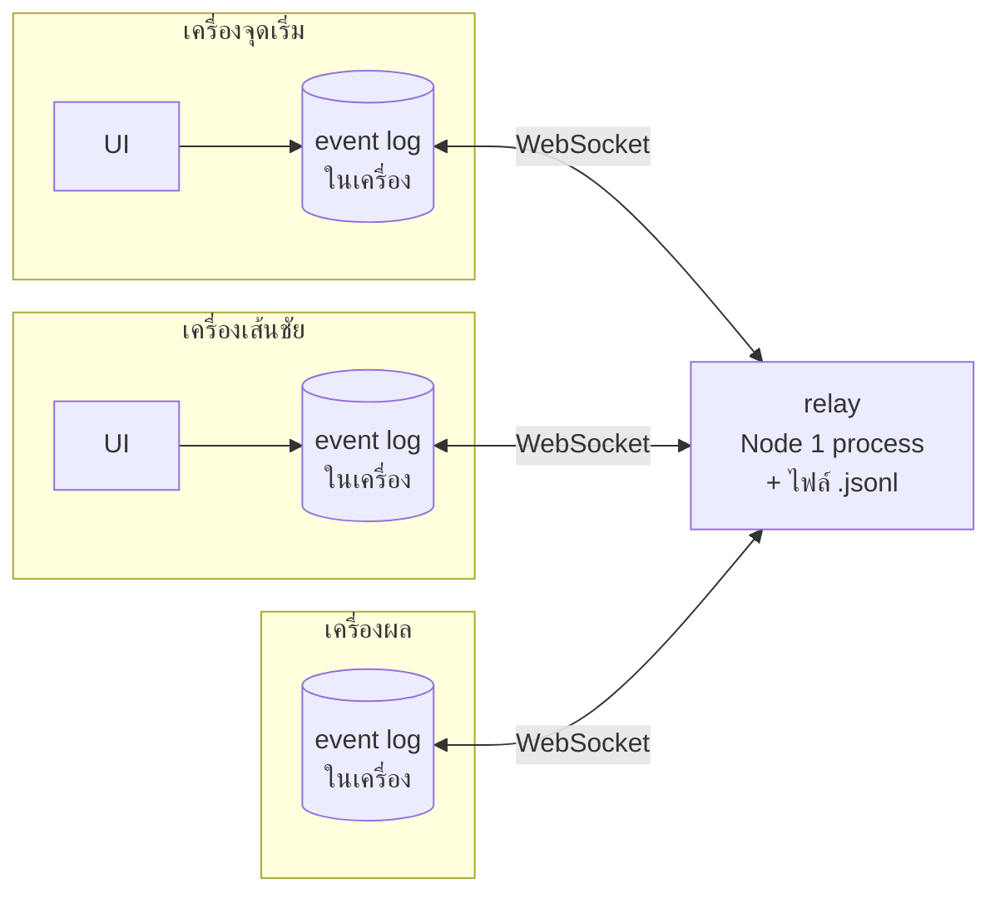

# จับเวลาวิ่ง — ระบบจับเวลาหลายเครื่องแบบเรียลไทม์

จับเวลาวิ่งโดยแยกเครื่องเป็น **จุดเริ่ม / เส้นชัย / ผล** เปิดในเบราว์เซอร์ได้ทุกเครื่อง
(มือถือ แท็บเล็ต โน้ตบุ๊ก) ไม่ต้องสมัคร ไม่ต้องติดตั้ง ทุกเครื่องเห็นกันทันที
และ **เน็ตหลุดก็ไม่เสียข้อมูล**

## ทำไมต้องออกแบบใหม่

เวอร์ชันก่อน (Next.js บน Vercel + Upstash Redis) ติดปัญหาที่แก้ปลายเหตุไม่จบ:

| ปัญหาเดิม | ต้นเหตุ | สถาปัตยกรรมใหม่ |
|---|---|---|
| นักวิ่งหาย/โผล่ไม่ครบที่เส้นชัย | Redis อ่านจาก replica → ได้ข้อมูลว่างหรือไม่ครบเป็นพักๆ | อุปกรณ์แลกเปลี่ยน *event* ที่ขาด ไม่ได้อ่าน "สถานะรวม" — อ่านไม่ครบก็แค่ได้ทีหลัง ไม่มีวันลบของที่มีอยู่ |
| ข้อมูลช้า 1–15 วินาที | Vercel เป็น serverless เปิด connection ค้างไม่ได้ (SSE โดน buffer) → ต้อง polling | WebSocket ค้างไว้ตลอด ส่งถึงทุกเครื่องภายในหลักสิบมิลลิวินาที |
| เน็ตหลุดตอนกด = เวลาหาย | ทุกอย่างต้องผ่านเซิร์ฟเวอร์ก่อน | บันทึกลงเครื่องก่อนเสมอ แล้วค่อยส่งเมื่อมีสัญญาณ |
| ผูกกับ Vercel + Redis | ต้องใช้คลาวด์สองเจ้า | Node process เดียว รันได้ทุกที่ — โน้ตบุ๊กในสนาม (ไม่ต้องมีอินเทอร์เน็ต) หรือโฮสต์ไหนก็ได้ |

## สถาปัตยกรรม



**1. ทุกการกระทำคือ event ที่แก้ไม่ได้** — `start` (ปล่อยตัวทั้งรอบ), `stop` (เข้าเส้น),
`cancel` (ยกเลิกนักวิ่ง), `void` (ย้อนกลับ event ใดก็ได้ = ปุ่ม "แตะผิด"/"เอาคืน")
สถานะการแข่งขันคำนวณจาก *เซตของ event* ด้วยฟังก์ชันบริสุทธิ์ [`fold()`](src/race.ts)
ลำดับที่มาถึง ข้อมูลซ้ำ หรือมาช้า ไม่เปลี่ยนผลลัพธ์ — ทุกเครื่องที่มี event ชุดเดียวกัน
แสดงผลเหมือนกันเป๊ะ (มีเทสต์สุ่มลำดับ 200 รอบยืนยัน) ถ้าเส้นชัยสองคนกดคนเดียวกัน
เวลาที่กดก่อนชนะ

**2. Local-first** — [`Room`](src/room.ts) เขียน event ลง `localStorage` ก่อนแตะเครือข่าย
ทุกครั้งที่ต่อติด จะดาวน์โหลด event ที่ตัวเองขาด และอัปโหลด event ที่ relay ขาด
แปลว่าแม้ relay รีสตาร์ทจนข้อมูลหาย อุปกรณ์ก็สร้างมันกลับคืนให้เอง
(เปิดหลายแท็บห้องเดียวกันในเครื่องเดียวก็ปลอดภัย — การบันทึกเป็นแบบรวม ไม่ทับกัน)

**3. Relay โง่โดยตั้งใจ** — [`server.js`](server.js) แค่ตรวจข้อมูล (สร้าง event ใหม่จาก
ฟิลด์ที่ตรวจแล้วเท่านั้น), เก็บต่อท้ายไฟล์ `data/<รหัส>.jsonl`, แล้วกระจายให้ทุกเครื่องในห้อง
ตรรกะการแข่งทั้งหมดอยู่ที่ฝั่งเครื่อง

**4. นาฬิกา** — แต่ละเครื่องวัด offset กับนาฬิกาของ relay แบบ NTP ผ่าน WebSocket
(ping ทุก 4 วิ, เลือกตัวอย่างที่ round-trip ต่ำสุดจาก 8 ครั้งล่าสุด) เวลาที่บันทึกคือ
**จังหวะที่นิ้วแตะจอ** (pointerdown) ไม่ใช่ตอนปล่อยนิ้วหรือตอนข้อมูลถึงเซิร์ฟเวอร์
ถ้ากดตอนยังไม่เคยซิงก์ (เช่น เปิดแอปในจุดอับสัญญาณ) จะเก็บเวลาดิบของเครื่องไว้
แล้วแปลงเป็นเวลากลางทันทีที่ซิงก์ได้ ทุกผลมี ± ความคลาดเคลื่อนกำกับ

## UX ที่ออกแบบมาเพื่อสนามจริง

- **ห้องแข่ง + รหัส 4 ตัว** — สร้างห้องที่เครื่องไหนก็ได้ ชวนเครื่องอื่นด้วย QR / ลิงก์ / พิมพ์รหัส
  (QR เลือกได้ว่าจะให้อีกเครื่องเปิดเป็นจุดเริ่ม เส้นชัย หรือผล) แยกข้อมูลทดสอบออกจากวันแข่งจริงได้เอง
- **เห็นว่าใครออนไลน์** — แถบล่างบอกจำนวนเครื่องในแต่ละบทบาท จุดเริ่มเห็นว่า "เส้นชัยพร้อม" ก่อนปล่อยตัว
- **สถานะชัดเจน** — ออนไลน์ / กำลังเชื่อมต่อ / ออฟไลน์ · รอส่ง N พร้อม ±ms ของการซิงก์เวลา
- **จุดเริ่ม** — เตรียมรายชื่อ, วางรายชื่อจาก Excel ทีละหลายบรรทัด, "เติมให้ครบ 8 เลน",
  ปุ่มปล่อยตัวใหญ่ และ **ยกเลิกรอบนี้** (ออกตัวผิด) ได้ทันทีจาก toast
- **เส้นชัย** — แถวใหญ่ทั้งแถวเป็นปุ่ม ตำแหน่ง**ไม่ขยับ**ระหว่างที่ยังมีคนวิ่ง
  (รอบเก่าจะหายเฉพาะตอนที่ลู่ว่างแล้วมีรอบใหม่ออกตัว) กดผิดคนกด **"แตะผิด"** ได้ทันที
  สั่นตอบรับเมื่อกด (ถ้าเครื่องรองรับ)
- **ผล** — อันดับพร้อมเหรียญ, กรองทีละรอบ, "หยุดผิด — ให้วิ่งต่อ", ลบผล (กู้คืนได้),
  ดาวน์โหลด CSV ที่เปิดใน Excel แล้วภาษาไทยไม่เพี้ยน
- **โหมดกลางแจ้ง/กลางคืน** — ธีมสว่างคอนทราสต์สูงอ่านกลางแดดได้ (ค่าเริ่มต้นตามเครื่อง) สลับได้ที่ ☀
- จอไม่ดับระหว่างใช้ (Wake Lock), ปิด pull-to-refresh กันรีเฟรชพลาด,
  เปิดแอปได้แม้ไม่มีสัญญาณ (service worker เมื่อใช้ผ่าน https)

## วิธีใช้งาน

### แบบที่ 1: โน้ตบุ๊กในสนาม (ไม่ต้องมีอินเทอร์เน็ต)

ต้องมี [Node.js](https://nodejs.org) 20.19 ขึ้นไป

```bash
npm install
npm run build
npm start
```

หน้าต่างจะแสดงที่อยู่ เช่น `WiFi เดียวกัน: http://192.168.1.23:8787` —
ให้มือถือทุกเครื่องต่อ WiFi/ฮอตสปอตเดียวกับโน้ตบุ๊กแล้วเปิดที่อยู่นั้น
(หรือกดรหัสห้องบนจอโน้ตบุ๊ก → สแกน QR ระบบเลือก IP ของ WiFi ให้เอง)

> ผ่าน http บน LAN ฟีเจอร์ที่เบราว์เซอร์จำกัดไว้เฉพาะ https (กันจอดับ, แชร์, เปิดออฟไลน์)
> จะปิดไปเงียบๆ ส่วนการจับเวลาและการบันทึกในเครื่องทำงานครบ

### แบบที่ 2: โฮสต์บนอินเทอร์เน็ต (ใช้ได้ทุกที่ ทุกเครือข่าย)

ใช้โฮสต์ใดก็ได้ที่รัน Node และรองรับ WebSocket เช่น Render, Railway, Fly.io หรือ VPS

- Build command: `npm install && npm run build`
- Start command: `npm start`
- ตัวแปรที่ใช้ได้: `PORT` (โฮสต์ส่วนใหญ่ตั้งให้เอง), `DATA_DIR` (ที่เก็บไฟล์ข้อมูล)
- **รันเครื่องเดียว (1 instance)** — ห้องทั้งหมดอยู่ใน process เดียว
- ดิสก์ของโฮสต์ฟรีมักหายเมื่อรีสตาร์ท — ไม่เป็นไร เพราะอุปกรณ์จะอัปโหลดข้อมูลคืนให้เองเมื่อต่อกลับ

> **Vercel ใช้กับ relay ไม่ได้** (serverless ไม่รองรับ WebSocket) ถ้าอยากวาง UI บนโฮสต์ static
> ให้ build ด้วย `VITE_RELAY_URL=wss://<relay ของคุณ>/ws npm run build`

### ขั้นตอนในวันแข่ง

1. เครื่องไหนก็ได้กด **สร้างการแข่งขันใหม่** → ได้รหัส เช่น `K7P2`
2. แตะรหัสที่หัวจอ → ให้เครื่องเส้นชัยสแกน QR (หรือพิมพ์รหัสที่หน้าแรก)
3. จุดเริ่ม: ใส่รายชื่อ → **ปล่อยตัว!** · เส้นชัย: แตะแถวของคนที่เข้าเส้น · ผล: ดูอันดับ/ดาวน์โหลด CSV

## พัฒนาและทดสอบ

```bash
npm run dev      # relay + Vite (hot reload) พอร์ตเดียว http://localhost:8787
npm test         # เทสต์ทั้งหมด (ต้องใช้ Node 23.6+ ที่รัน TypeScript ได้เอง)
npm run check    # typecheck + test + build
```

เทสต์มี 2 ชุด:
- [`test/race.test.ts`](test/race.test.ts) — ตรรกะการแข่ง: ลำดับ/ข้อมูลซ้ำไม่มีผล, กดซ้ำคนเดียวกัน, undo ทุกแบบ,
  แถวเส้นชัยไม่ขยับ, รูปแบบเวลา, CSV กันสูตร Excel
- [`test/relay.test.ts`](test/relay.test.ts) — รัน relay จริง + โค้ดซิงก์จริงหลาย "เครื่อง":
  ส่งถึงกันภายใน 250ms, ห้องแยกกัน, relay ปฏิเสธข้อมูลขยะ, กดตอนเน็ตหลุดแล้วรีโหลดหน้า
  ข้อมูลไม่หาย, relay ดิสก์หายแล้วอุปกรณ์สร้างคืน, เครื่องที่นาฬิกาเพี้ยน 5 วินาทีและยังไม่เคยซิงก์ยังได้เวลาถูก,
  สองแท็บในเบราว์เซอร์เดียวไม่ลบข้อมูลกัน

## โครงสร้างไฟล์

```
server.js          relay WebSocket + เสิร์ฟหน้าเว็บ (Node ล้วน + ws)
src/race.ts        ชนิด event, fold(), จัดแถวเส้นชัย, รูปแบบเวลา, CSV — ฟังก์ชันบริสุทธิ์
src/room.ts        การซิงก์ฝั่งเครื่อง: WebSocket, นาฬิกา, คิวออฟไลน์, localStorage
src/ui.tsx         hooks และชิ้นส่วน UI ที่ใช้ร่วมกัน
src/Home.tsx       หน้าแรก: สร้าง/เข้าร่วมการแข่งขัน
src/RoomView.tsx   โครงหน้าห้อง: หัวจอ สถานะ แชร์ QR แถบบทบาท
src/StartTab.tsx · FinishTab.tsx · ResultsTab.tsx
```

## ข้อจำกัด

- รหัสห้องคือกุญแจ — ใครรู้รหัสเข้าร่วม/แก้ผลได้ (เหมาะกับกีฬาสี ไม่ใช่การแข่งชิงรางวัลเงิน)
- ปล่อยตัวได้สูงสุด 100 คนต่อรอบ, 5,000 event ต่อห้อง (ทั้งวันกีฬาสีใช้ไม่กี่ร้อย)
- ความแม่นยำขึ้นกับความหน่วงเครือข่าย: WiFi วงเดียวกันได้หลักมิลลิวินาที, 4G ราว ±20–50ms —
  ทุกผลแสดง ± กำกับไว้
