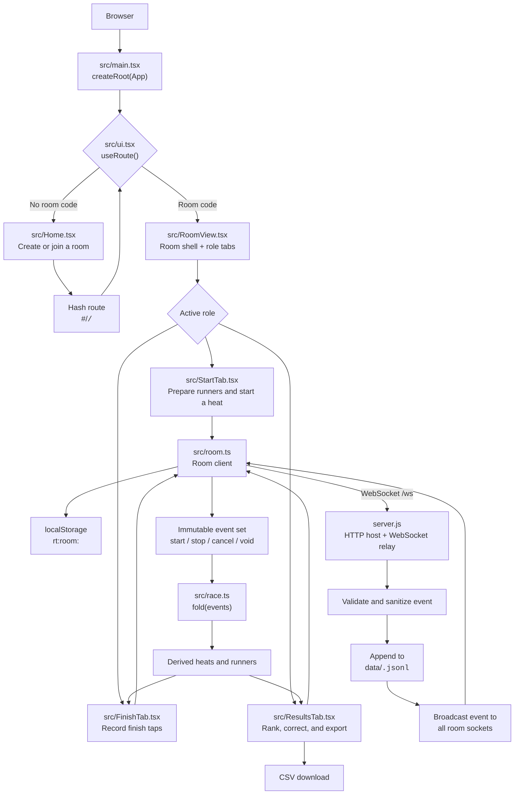
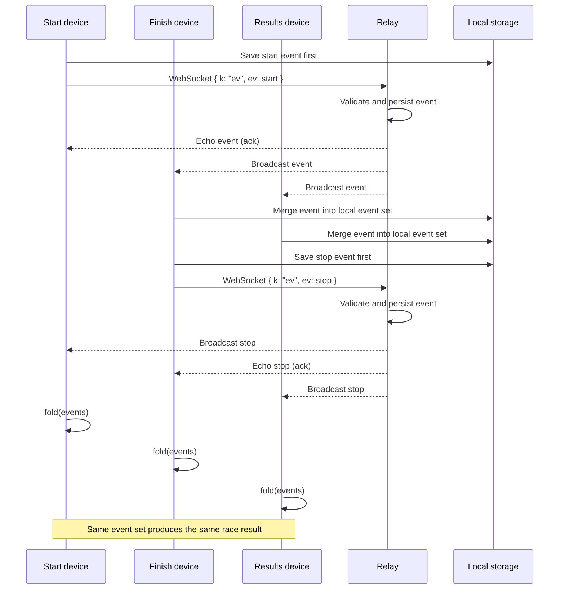
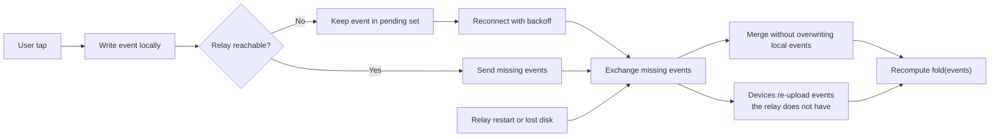

# Repository flow

This diagram follows one race from the browser entry point through the
role-specific screens, local persistence, WebSocket relay, event folding, and
result export.

## End-to-end flow

## Race event sequence

## Offline and recovery path

## Code map

| Responsibility | File |
|---|---|
| Browser bootstrap and production service worker registration | `src/main.tsx` |
| Hash routing, storage helpers, room lifecycle, tap timestamps | `src/ui.tsx` |
| Room state, WebSocket sync, retries, clock synchronization | `src/room.ts` |
| Event types, deterministic state folding, timing, CSV formatting | `src/race.ts` |
| Role-based room shell and sharing QR | `src/RoomView.tsx` |
| Start, finish, and results workflows | `src/StartTab.tsx`, `src/FinishTab.tsx`, `src/ResultsTab.tsx` |
| Static hosting, WebSocket relay, validation, persistence | `server.js` |
| End-to-end resilience coverage | `test/*.test.ts` |
