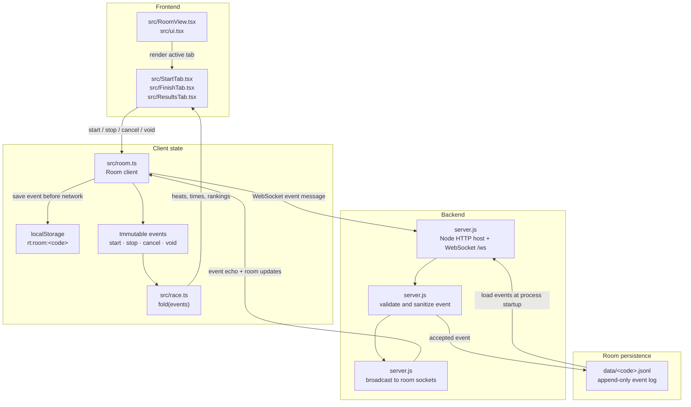

# Repository flow

The current repository runs as a React/Vite frontend connected to a single
Node.js WebSocket relay. The previous Vercel + Upstash Redis architecture is
mentioned in `README.md` only as a retired design; there are no current Vercel
deployment files or Redis/Upstash dependencies, so they are not shown here.

## Main data flow



## “Tap finish” sequence

```mermaid
sequenceDiagram
    participant Finish as src/FinishTab.tsx
    participant Room as src/room.ts
    participant Store as localStorage
    participant WS as WebSocket /ws
    participant Server as server.js
    participant Disk as data/<code>.jsonl
    participant Other as Other room devices
    participant Race as src/race.ts
    participant Results as src/ResultsTab.tsx

    Finish->>Finish: useTapTime().take(rid)
    Finish->>Room: room.stop(rid, at)
    Room->>Room: commit({ type: "stop", ... })
    Room->>Store: changed() → save()
    Room->>Room: pending.add(ev.id)
    Room->>Room: flush()
    Room->>WS: send({ k: "ev", ev })
    WS->>Server: JSON event frame
    Server->>Server: clean(msg.ev)
    Server->>Disk: store(room, ev)
    Disk-->>Server: appendFileSync(<code>.jsonl)
    Server-->>Other: send({ k: "ev", ev })
    Server-->>WS: send({ k: "ev", ev }) ack
    WS-->>Room: receive({ k: "ev", ev })
    Room->>Room: learn(ev) → pending.delete(ev.id)
    Room->>Race: fold(room.events.values())
    Race-->>Results: derived heats, runners, and finish times

    alt Network is down
        Room->>Room: flush() cannot send; pending event remains
        Room->>Store: save() keeps event + pending ID
        Note over Finish,Store: UI remains usable and the tap is not lost
    else Network reconnects
        Room->>WS: connect() after retry backoff
        Room->>Server: hello({ room, role })
        Server-->>Room: log(events) catch-up
        Room->>Room: receive(log) → learn(event)
        Room->>Room: fixUnsynced() and flush()
        Room->>WS: resend pending event(s)
        WS->>Server: JSON event frame
        Server->>Server: if (r.events.has(id)) return existing event
        Server-->>Room: existing event echo; no duplicate append
        Room->>Race: fold(room.events.values())
        Race-->>Results: recovered result state
    end

    opt Duplicate event ID arrives
        Server->>Server: r.events.has(id)
        Server-->>WS: send existing { k: "ev", ev }
        Note over Server,Disk: Ignore duplicate ID; do not append twice
        Room->>Room: learn(ev) deduplicates by event ID
    end
```

### Flow summary

- The role tabs in `src/StartTab.tsx`, `src/FinishTab.tsx`, and
  `src/ResultsTab.tsx` create or display race events through `src/room.ts`.
- `src/room.ts` writes locally first, then sends missing events to
  `server.js` over WebSocket. This preserves taps during network loss.
- `server.js` validates each event, appends it to
  `data/<code>.jsonl`, and broadcasts it to every connected device in the
  room.
- `src/race.ts` deterministically folds the shared event set into heats,
  runners, finish times, and rankings. Results are therefore recalculated on
  each client rather than read from a central database.
- Deployment is a plain Node process started with `npm start` (or
  `npm run dev` for Vite middleware). The repository contains no active
  Vercel or Redis/Upstash deployment integration.
